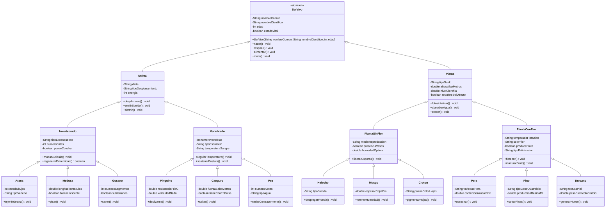

# Herencia - Seres Vivos

Ejercicio de Programacion Orientada a Objetos en Java que modela una jerarquia de seres vivos
en 4 niveles para practicar **herencia**, **clases abstractas**, **encapsulamiento** y **polimorfismo**.

## Estructura del proyecto

```
HerenciaSeresVivos/
├── .vscode/settings.json
├── lib/
├── src/
│   ├── App.java                  <- clase principal (main)
│   └── pkgSeresVivos/
│       ├── SerVivo.java          <- Nivel 1 (abstracta)
│       ├── Animal.java           <- Nivel 2
│       ├── Planta.java           <- Nivel 2
│       ├── Invertebrado.java     <- Nivel 3
│       ├── Vertebrado.java       <- Nivel 3
│       ├── PlantaSinFlor.java    <- Nivel 3
│       ├── PlantaConFlor.java    <- Nivel 3
│       ├── Arana.java  Medusa.java  Gusano.java      <- Nivel 4
│       ├── Pinguino.java  Canguro.java  Pez.java     <- Nivel 4
│       ├── Helecho.java  Musgo.java  Croton.java     <- Nivel 4
│       └── Pera.java  Pino.java  Durazno.java        <- Nivel 4
└── bin/                          <- compilados (ignorado por git)
```

## Diagrama UML


